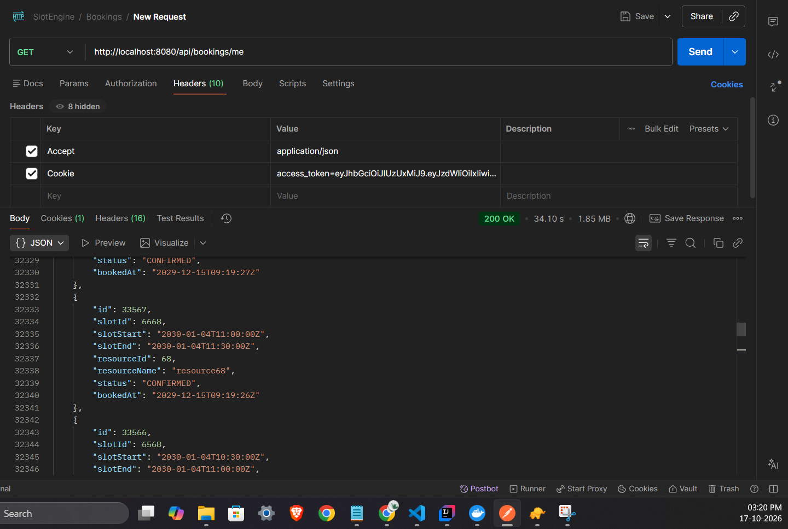
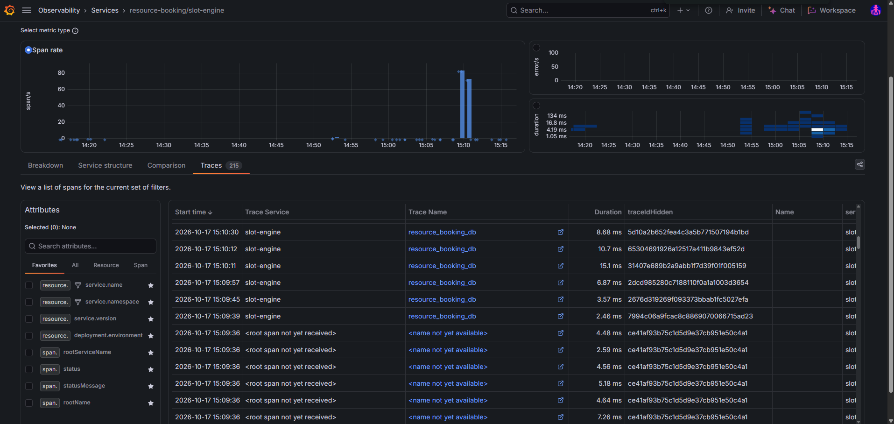
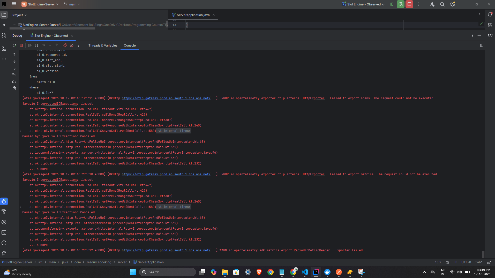

# Unbounded booking-history smoke check

Date: 2026-10-17

This was one manual request before pagination, not an official performance run.

## Result

- Endpoint: `GET /api/bookings/me`
- Test user bookings: 10,000
- HTTP status: `200 OK`
- Postman duration: `34.10 s`
- Response size: `1.85 MB`
- Grafana received a large burst of JDBC spans, but the root span was not received.
- The OTel agent later timed out while exporting spans and metrics.

The request completed successfully, but returning every booking produced a large response and more telemetry than the exporter handled cleanly. Formal before/after measurements start after pagination is added.

## Screenshots

